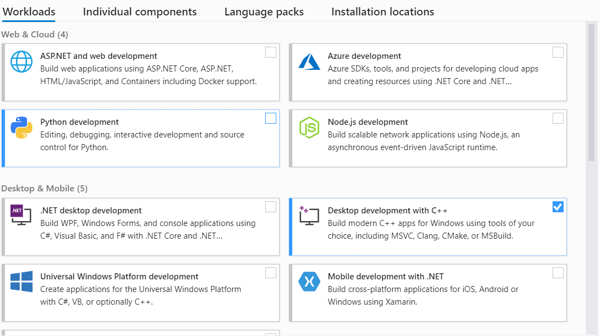
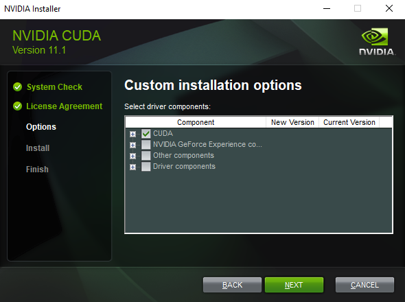

# Custom Operator Samples

We hope these custom operators can be a starting point to developing for anybody including members of the community only beginning with c++ development.

A few basic examples can be found in the Samples/CPlusPlus folder of the TouchDesigner Installation. This repository contains more complex examples, some of which depend on more external libraries.

> Tip: You can kick-start your custom operators projects by using the Cpp Pars Template Generator (cppParsTemplateGen) available in TouchDesigner's Palette to generate a Parameters class that will mimic the custom parameters of a reference COMP. For more informations, please [visit the wiki](https://docs.derivative.ca/Palette:cppParsTemplateGen).

* [List of Operators](#Operators)
* [Compiling Custom Operators](#Compiling-Custom-Operators)
  * [Installing Visual Studio](#installing-visual-studio-community-edition-windows-only)
  * [Installing CMake](#installing-cmake)
  * [Installing CUDA Toolkit](#installing-the-cuda-toolkit-windows-only)
  * [Installing the ONNX Runtime](#installing-the-onnx-runtime-windows-only)
  * [Using TouchDesigner's Python](#using-touchdesigners-python)
  * [Referencing OpenCV libraries](#Referencing-OpenCV-libraries)
    * [Windows](#windows-1)
    * [MacOS](#macos-1)
    * [Using external OpenCV libraries](#using-external-opencv-libraries)
* [Building with CMake](#building-with-cmake)
  * [Building all samples](#building-all-samples)
  * [Building a single sample](#building-a-single-sample)
  * [CMake options](#cmake-options)
  * [Adding your own operator](#adding-your-own-operator)
* [Compiling OpenCV with CUDA support](#Compiling-OpenCV-with-CUDA-support)
  * [Prerequisites](#Prerequisites)
  * [Create OpenCV build files (Windows)](#generating-opencv-build-files-with-cmake-windows)
* [CUDA and NVIDIA hardware compatability](#Specifying-the-Nvidia-GPUs-to-generate-Code-for)
* [Fixes for OpenCV or CUDA version updates](#Fixes-for-OpenCV-or-CUDA-version-updates)
* [Loading Custom Operators in TouchDesigner](#Loading-Custom-Operators-in-TouchDesigner)

## Operators

* **TOP Family**
  * [FilterTOP](TOP/BasicFilterTOP)
  * [CPUMemoryTOP](TOP/CPUMemoryTOP)
  * [CannyEdgeTOP](TOP/CannyEdgeTOP)
  * [CudaTOP](TOP/CudaTOP)
  * [DistanceTransformTOP](TOP/DistanceTransformTOP)
  * [ObjectDetectorTOP](TOP/ObjectDetectorTOP)
  * [OpenGLTOP](TOP/OpenGLTOP)
  * [OpticalFlowCPUTOP](TOP/OpticalFlowCPUTOP)
  * [OpticalFlowGPUTOP](TOP/OpticalFlowGPUTOP)
  * [SpectrumTOP](TOP/SpectrumTOP)
  * [ONNXCandyStyleTOP](TOP/ONNXCandyStyleTOP)
* **CHOP Family**
  * [FilterCHOP](CHOP/BasicFilterCHOP)
  * [GeneratorCHOP](CHOP/BasicGeneratorCHOP)
  * [OneEuroCHOP](CHOP/OneEuroCHOP)
  * [TimesliceFilterCHOP](CHOP/TimeSliceFilterCHOP)
  * [TimesliceGeneratorCHOP](CHOP/TimeSliceGeneratorCHOP)
* **SOP Family**
  * [FilterSOP](SOP/FilterSOP)
  * [GeneratorSOP](SOP/GeneratorSOP)
  * [IntersectPointsSOP](SOP/IntersectPointsSOP)
  * [SpiralSOP](SOP/SpiralSOP)
  * [SprinkleSOP](SOP/SprinkleSOP)
  * [WrapPointsSOP](SOP/WrapPointsSOP)
* **DAT Family**
  * [FilterDAT](DAT/FilterDAT)
  * [GeneratorDAT](DAT/GeneratorDAT)
  
## Compiling Custom Operators

This text should be a small guide to getting started with compiling custom operators that can be found on github or elsewhere as pure source code. Often setting up your environment is the most difficult step followed by making accessible all libraries that might be necessary for successfully compiling other’s projects.

### Installing Visual Studio Community Edition (Windows only)

*   Download the latest Visual Studio Community Edition from: [https://visualstudio.microsoft.com/vs/community/](https://visualstudio.microsoft.com/vs/community/)
*   Start the installation process
*   In the Installer, select “Desktop Development with C++” and proceed with the installation process



### Installing CMake

All samples are built with [CMake](https://cmake.org/), a cross platform build system that generates Visual Studio solutions on Windows and Xcode projects (or Makefiles) on macOS from the same `CMakeLists.txt` files. CMake 4.4 or newer is required; check with `cmake --version`.

#### Windows

Visual Studio's “Desktop Development with C++” workload includes a copy of CMake, and Visual Studio can open any folder containing a `CMakeLists.txt` directly (File > Open > Folder). That copy may be older than CMake 4.4, in which case configuring stops with an error saying CMake 4.4 is required. Install the current release from [https://cmake.org/download/](https://cmake.org/download/) to use it from a terminal or the CMake GUI, or to generate a Visual Studio solution.

#### MacOS

The easiest way to install CMake is via [Brew](https://brew.sh/). Once `brew` is installed and setup, you can install `cmake` by running:
```bash
% brew install cmake
```

### Installing the CUDA Toolkit (Windows only)

_For some of the projects a CUDA Development environment is required. Which version much depends on the TouchDesigner version the operator is targeted at. Check [https://docs.derivative.ca/CUDA](https://docs.derivative.ca/CUDA) for more information._

*   Download the CUDA Toolkit from here: [https://developer.nvidia.com/cuda-toolkit](https://developer.nvidia.com/cuda-toolkit) . Legacy versions of the CUDA Toolkit can be found here: [https://developer.nvidia.com/cuda-toolkit-archive](https://developer.nvidia.com/cuda-toolkit-archive)
*   During installation choose “Custom” and **be careful to only select the CUDA component.** The other options will install most likely outdated driver components.



The toolkit's major version must match the CUDA version TouchDesigner uses, currently **CUDA 12**: the plugins link the shared CUDA runtime, and TouchDesigner only ships the runtime DLL for its own major version (`cudart64_12.dll`). Any 12.x toolkit works. CMake checks this when configuring and skips the CUDA samples, with a message, if the toolkit it finds is another major version.

CMake finds the CUDA 12 toolkit automatically, even if other CUDA versions are installed too: it picks the newest 12.x toolkit from the default install folder (`C:/Program Files/NVIDIA GPU Computing Toolkit/CUDA/v12.*`) or from the `CUDA_PATH_V12_*` environment variables the installer sets, rather than the default toolkit (`CUDA_PATH`, which points at the last toolkit installed). The toolkit it chose is printed when you configure. To pick one yourself, pass `-DCMAKE_CUDA_COMPILER="C:/Program Files/NVIDIA GPU Computing Toolkit/CUDA/v12.8/bin/nvcc.exe"`, or with the Visual Studio generator, `-T cuda=12.8`, in a fresh build folder.

CUDA 12 doesn't support Visual Studio 2026, so build the CUDA samples with **Visual Studio 2022**: generate with `-G "Visual Studio 17 2022"`, or use Ninja from a Visual Studio 2022 developer prompt. With the Visual Studio 2026 generator or compiler, CMake reports this and skips the CUDA samples (or stops, when configuring one of them on its own).

### Installing the ONNX Runtime (Windows only)

Samples that run ONNX AI models, such as [ONNXCandyStyleTOP](TOP/ONNXCandyStyleTOP), use the [ONNX Runtime](https://onnxruntime.ai) C API.

* They require TouchDesigner 2025.32302 or later, installed via the Web Installer with the 'Public ONNX' installer option selected. This is due to a conflict with the `onnxruntime.dll` version that Kinect Azure requires.
* They require ONNX Runtime version 1.23.2, for CUDA 12. Download it from the [ONNX Runtime GitHub releases](https://github.com/microsoft/onnxruntime/releases/download/v1.23.2/onnxruntime-win-x64-gpu-1.23.2.zip) and unzip it into `C:/Program Files/onnxruntime`, so that these folders exist with the `.lib` and `.h` files:
  * `C:/Program Files/onnxruntime/lib`
  * `C:/Program Files/onnxruntime/include`
* CMake looks for the ONNX Runtime headers and libraries in `C:/Program Files/onnxruntime` by default. To use another location, configure with `-DONNXRUNTIME_ROOT=<path>`.
* Only the headers and `.lib` files are used to build. The `.dll` files from the download are not used: the plugin loads the `onnxruntime.dll` that comes with TouchDesigner.

### Using TouchDesigner's Python

An operator that uses Python's C API is built against the Python that ships with TouchDesigner, so it matches the interpreter it's loaded into; add `PYTHON` to its `td_add_custom_op()` call (see [Adding your own operator](#adding-your-own-operator)). No separate Python install is needed:

* Windows: TouchDesigner 2025 series builds bundle Python's headers in `<TD_INSTALLATION_PATH>/Samples/CPlusPlus/3rdParty/Python/Include` and `Include/PC` (where `pyconfig.h` is) and its import library (`python3XX.lib`) in `<TD_INSTALLATION_PATH>/Samples/CPlusPlus/3rdParty/Python/lib/x64`.
* macOS: the headers come from `<TD_INSTALLATION_PATH>/Contents/Frameworks/Python.framework`. The plugin isn't linked against a Python library; it uses the Python TouchDesigner has already loaded.

These samples require Python 3.11, the Python that the TouchDesigner builds they target ship; configuring stops with a message if the installation has another Python, which usually means `TD_INSTALLATION_PATH` points at a different TouchDesigner series. The required version is set by `TD_PYTHON_VERSION` and `TD_PYTHON_FREE_THREADED` in `cmake/TouchDesignerCustomOP.cmake`.

On Windows these operators always use the release C runtime, because the debug runtime would make Python's `pyconfig.h` switch to a debug build of Python. The Python version found is shown in the configure output, e.g. `Adding CHOP sample: BasicGeneratorCHOP (Python 3.11 from TouchDesigner)`.

### Referencing OpenCV libraries

_Some projects make use of various OpenCV modules._

The samples are written for **OpenCV 4** and are compiled against the OpenCV that ships with the TouchDesigner build you point CMake at, so the plugins use the same headers and libraries TouchDesigner loads. When configuring, CMake reads the OpenCV version from that install's `opencv2/core/version.hpp` and stops with a message if it isn't OpenCV 4.x. The version is shown next to each OpenCV sample in the configure output, e.g. `Adding TOP sample: ContoursTOP (OpenCV 4.11.0 from TouchDesigner)`.

These samples are for the **TouchDesigner 2025 series**. They find everything they use from TouchDesigner's installation through one CMake variable, **TD_INSTALLATION_PATH**, which points at the root of the install of the latest 2025 series build. If TouchDesigner is installed in its default location you don't need to set it:

* Windows: the install folder, default `C:/Program Files/Derivative/TouchDesigner`
* macOS: the application bundle, default `/Applications/TouchDesigner.app`

```bash
cmake -S . -B build -DTD_INSTALLATION_PATH="D:/Apps/TouchDesigner.2025.31550"
```

The installation path is printed when you configure.

#### Windows
Since TouchDesigner 2020.44130, OpenCV libraries are included in the TouchDesigner Install folder at Samples\CPlusPlus\3rdParty. CMake takes the headers and libraries from `<TD_INSTALLATION_PATH>/Samples/CPlusPlus/3rdParty/opencv`.

The library names carry the OpenCV version (e.g. `opencv_core4110.lib` for OpenCV 4.11.0). CMake links the libraries whose version matches the headers, so there is no need to edit library names when TouchDesigner updates OpenCV, and libraries left over from another version are never picked up.

**Note:** The OpenCV libraries shipped with TouchDesigner are "Release" binaries. To still allow Debug builds, samples linking TouchDesigner's OpenCV always use the release C runtime (`/MD`), in every configuration.

#### MacOS
TouchDesigner also bundles OpenCV on macOS: CMake takes the headers from `<TD_INSTALLATION_PATH>/Contents/Resources/tfs/Samples/CPlusPlus/3rdParty/opencv/include/opencv4` and the `.dylib`s matching their version (e.g. `libopencv_core.4.11.0.dylib`) from `<TD_INSTALLATION_PATH>/Contents/Frameworks`. The plugins are given an rpath to TouchDesigner's Frameworks folder, so they load the same OpenCV that TouchDesigner uses.

If TouchDesigner's OpenCV isn't found at all, CMake falls back to a regular install, e.g. `brew install opencv`, which must also be OpenCV 4.x. It doesn't fall back when TouchDesigner's OpenCV is there but is another major version or is missing a library, since the plugin would then not match the OpenCV TouchDesigner loads.

#### Using external OpenCV libraries

If you want to use a different OpenCV 4 release than the one that ships with TouchDesigner, or OpenCV is installed in a non-standard location, point CMake at the folder containing `OpenCVConfig.cmake`:

```bash
cmake -S . -B build -DTD_USE_BUNDLED_OPENCV=OFF -DOpenCV_DIR="C:/opencv/build"
```

If you additionally need CUDA support, follow instructions [below](#Compiling-OpenCV-with-CUDA-support) to compile OpenCV with CUDA support. Remember to place the OpenCV DLLs next to your plugin (see [Loading Custom Operators](#Loading-Custom-Operators-in-TouchDesigner)).

## Compiling OpenCV with CUDA support (Not necessary for building these examples.)

**Note:** This is not necessary for compiling these operators - in fact TouchDesigner comes with all necessary binaries precompiled. We'll leave this guide here as the instructions were hard to find initialy.

_Some other projects require the OpenCV windows libraries with CUDA modules included, yet as the available pre-built versions do not offer this support, OpenCV has to be recompiled with the required CUDA modules enabled. A good guide to follow can be found here: [https://jamesbowley.co.uk/accelerate-opencv-4-3-0-build-with-cuda-and-python-bindings/](https://jamesbowley.co.uk/accelerate-opencv-4-3-0-build-with-cuda-and-python-bindings/)_

### Prerequisites

*   Visual Studio (using _Visual Studio 2019_ in this example)
*   The sources for [OpenCV](https://github.com/opencv/opencv) and [OpenCV Contrib](https://github.com/opencv/opencv_contrib)
*   [CMake](https://cmake.org/download/)
*   [CUDA Toolkit](https://developer.nvidia.com/cuda-toolkit)
*   _Optional:_ for video decoding on the gpu - [Nvidia Video Codec SDK](https://developer.nvidia.com/nvidia-video-codec-sdk)
*   Extract and copy the contents of the **Interface** directory to the **include** directory and the **Lib** directory to the **lib** directory inside your CUDA installation.
*   _Optional:_ for DNN CUDA backend support - [cuDNN](https://developer.nvidia.com/rdp/form/cudnn-download-survey)
*   Extract and copy the **bin**, **include** and **Lib** directories to your CUDA installation

### Generating OpenCV build files with CMake (Windows)

The original instructions ask for running everything in a Command Prompt, arguably it’s easier to create a .bat file.

*   create a .bat file and open it in your editor:

```
set "openCvSource=PATH_TO_OPENCV_SOURCE"
set "OpenCVExtraModules=PATH_TO_OPENCV_CONTRIB_MODULES"
set "openCvBuild=%openCvSource%\build"
set "buildType=Release"
set "generator=Visual Studio 16 2019"
"C:\Program Files\CMake\bin\cmake.exe" -B"%openCvBuild%/" -H"%openCvSource%/" -G"%generator%" -DCMAKE_BUILD_TYPE=%buildType% -DOPENCV_EXTRA_MODULES_PATH="%OpenCVExtraModules%/" -DINSTALL_TESTS=ON -DINSTALL_C_EXAMPLES=ON -DBUILD_EXAMPLES=ON -DBUILD_opencv_world=ON -DWITH_CUDA=ON -DCUDA_TOOLKIT_ROOT_DIR="C:/Program Files/NVIDIA GPU Computing Toolkit/CUDA/v10.2" -DCUDA_FAST_MATH=ON -DWITH_CUBLAS=ON -DCUDA_ARCH_PTX=7.5 -DWITH_NVCUVID=ON -DWITH_OPENGL=ON -DWITH_MFX=ON
```

*   run the bat file in a Terminal or Command Prompt
*   make changes to the configuration as required using the CMake GUI
*   open the OpenCV.sln in Visual Studio
*   In the **Solution Explorer**, expand **CMakeTargets** and right click on **Install**, selecting **Build**

**Note:** During the process of generating the build files with CMake, an error can occur when running on a ExFAT filesystem: 

```
CMake Error: Problem extracting tar: e:/git/opencv/.cache/ippicv/879741a7946b814455eee6c6ffde2984-ippicv_2020_win_intel64_20191018_general.zip
CMake Error at cmake/OpenCVDownload.cmake:240 (message):
IPPICV: Unpack failed: 1
```

This can be resolved by using 7zip as explained here: [https://stackoverflow.com/a/61489779](https://stackoverflow.com/a/61489779)

## Specifying the Nvidia GPUs to generate Code for

The CUDA samples compile real GPU code for the Pascal to Hopper architectures (`sm_60` … `sm_90`) plus PTX for older (`compute_50`) and future GPUs, which the driver compiles just-in-time. To change this, set the standard CMake variable `CMAKE_CUDA_ARCHITECTURES` when configuring, e.g. only for an RTX 40-series card:

```bash
cmake -S . -B build -DCMAKE_CUDA_ARCHITECTURES="89"
```

For a reference on GPU compilation and virtual as well as gpu features, please refer to the [nvcc documentation](https://docs.nvidia.com/cuda/cuda-compiler-driver-nvcc/index.html#virtual-architectures) and the [CMAKE_CUDA_ARCHITECTURES documentation](https://cmake.org/cmake/help/latest/variable/CMAKE_CUDA_ARCHITECTURES.html).

## Fixes for Cuda version `< 12.4` compilation error

Microsoft Visual Studio 2022 might throw an error due to the toolset (v143) compatibility version with MSC_VER expected by the CUDA toolkit.

A `MSB3721` error and `C1189`	error referencing the `C:\Program Files\NVIDIA GPU Computing Toolkit\CUDA\v11.8\include\crt\host_config.h` can arise.

Configure with `-DTD_CUDA_ALLOW_UNSUPPORTED_COMPILER=ON` to remedy this. It passes [the following flags](https://stackoverflow.com/a/78576792/11056845) to the compilers: `-allow-unsupported-compiler -D_ALLOW_COMPILER_AND_STL_VERSION_MISMATCH` (the second half allows Visual Studio to accept Cuda < 12.4).

## Fixes for OpenCV or CUDA version updates

Some newer TouchDesigner Versions might be delivered with an updated OpenCV and/or require a newer CUDA Version.

### Changing the OpenCV version

Within the same major version there is nothing to change: CMake reads the version from TouchDesigner's OpenCV headers and links the libraries that match it. Re-run CMake (or delete the `build` folder) after updating TouchDesigner.

The required major version is set by `TD_OPENCV_MAJOR_VERSION` in `cmake/TouchDesignerCustomOP.cmake`. When the samples move to a TouchDesigner build with a new OpenCV major version, update it there (along with any source changes the new OpenCV requires).

### Changing the CUDA version

Install the CUDA Toolkit version matching the major version of CUDA (11, 12 etc.) that the version of TouchDesigner you are using is on, then re-configure in a fresh build folder. The required major version is set by `TD_CUDA_MAJOR_VERSION` in `cmake/TouchDesignerCUDAToolkit.cmake`; if it's not the one your TouchDesigner uses, update it there. See [Installing the CUDA Toolkit](#installing-the-cuda-toolkit-windows-only) for selecting a specific toolkit when several are installed.

## Building with CMake

Every sample folder has its own `CMakeLists.txt`, and the repository root has a `CMakeLists.txt` that builds all samples in one project. Both use the shared helper in [`cmake/TouchDesignerCustomOP.cmake`](cmake/TouchDesignerCustomOP.cmake).

The compiled plugins (`.dll` on Windows, `.plugin` bundles on macOS) are written to a `plugins` folder inside the build folder, e.g. `build/plugins/BasicFilterCHOP.dll`.

### Installing into TouchDesigner

TouchDesigner loads custom operators from its system-wide Plugins folder when it starts. After building, copy the plugins there with:

```bash
cmake --install build --config Release
```

The default install folder is:

* Windows: `Documents/Derivative/Plugins` (your actual Documents folder, also when it's redirected, e.g. to OneDrive)
* macOS: `~/Library/Application Support/Derivative/TouchDesigner099/Plugins`

To install somewhere else, such as a `Plugins` folder next to your `.toe` file, pass `--prefix <folder>` to `cmake --install`, or set `CMAKE_INSTALL_PREFIX` when configuring. Restart TouchDesigner to pick up a newly installed plugin.

### Building all samples

```bash
cmake -S . -B build
cmake --build build --config Release
```

On Windows this generates `build/CustomOperatorSamples.sln`, with the samples grouped into CHOP / DAT / SOP / TOP folders. On macOS add `-G Xcode` to get an Xcode project instead of Makefiles.

Samples whose dependencies aren't available (OpenCV, the CUDA Toolkit, the ONNX Runtime) or that don't support the current platform (the CUDA samples are Windows only) are skipped with a warning, and the rest still build. Use `-DTD_BUILD_CHOPS=OFF` (or `_DATS`, `_SOPS`, `_TOPS`) to leave out an operator family.

### Building a single sample

Configure the sample's folder directly:

```bash
cd CHOP/BasicFilterCHOP
cmake -S . -B build
cmake --build build --config Release
```

On Windows you can also open `build/BasicFilterCHOP.sln`, or open the sample folder in Visual Studio with File > Open > Folder. When building a single sample, a missing dependency is an error instead of a warning.

_Generators: use `-G` to choose a specific generator, such as `-G "Visual Studio 17 2022"`, `-G Xcode` or `-G "Unix Makefiles"`._

Visual Studio and Xcode are set up to launch TouchDesigner (with `TOUCH_TEXT_CONSOLE=1`) when you start debugging a plugin. This uses the TouchDesigner in `TD_INSTALLATION_PATH`; set `TD_EXECUTABLE` only to debug with a different executable.

### CMake options

| Option | Default | Description |
| --- | --- | --- |
| `TD_BUILD_CHOPS` / `TD_BUILD_DATS` / `TD_BUILD_SOPS` / `TD_BUILD_TOPS` | `ON` | Root project only: which operator families to build. |
| `TD_PLUGIN_OUTPUT_DIR` | `<build folder>/plugins` | Folder the built plugins are written to. |
| `CMAKE_INSTALL_PREFIX` | TouchDesigner's Plugins folder | Where `cmake --install` copies the plugins (see [Installing into TouchDesigner](#installing-into-touchdesigner)). |
| `TD_INSTALLATION_PATH` | `C:/Program Files/Derivative/TouchDesigner` (Windows), `/Applications/TouchDesigner.app` (macOS) | Root of the TouchDesigner installation. Its bundled OpenCV and the debugger executable are found relative to it. |
| `TD_USE_BUNDLED_OPENCV` | `ON` | Link TouchDesigner's OpenCV. `OFF` uses `find_package(OpenCV)` / `OpenCV_DIR`. |
| `ONNXRUNTIME_ROOT` | `C:/Program Files/onnxruntime` | Location of the extracted ONNX Runtime package (see [Installing the ONNX Runtime](#installing-the-onnx-runtime-windows-only)). |
| `CMAKE_CUDA_ARCHITECTURES` | see [above](#Specifying-the-Nvidia-GPUs-to-generate-Code-for) | GPU architectures for the CUDA samples. |
| `TD_CUDA_ALLOW_UNSUPPORTED_COMPILER` | `OFF` | Windows: allow CUDA < 12.4 with newer Visual Studio toolsets. |
| `TD_EXECUTABLE` | _empty_ (TouchDesigner in `TD_INSTALLATION_PATH`) | Program launched when debugging from Visual Studio / Xcode. |
| `CMAKE_OSX_DEPLOYMENT_TARGET` | `12.0` | macOS: oldest macOS version the plugins run on. |

### Adding your own operator

Copy one of the samples (keep it two folders below the repository root, or adjust the `include()` path to `cmake/TouchDesignerCustomOP.cmake`), rename it, and update its `CMakeLists.txt`:

```cmake
cmake_minimum_required(VERSION 4.4)
include(${CMAKE_CURRENT_LIST_DIR}/../../cmake/TouchDesignerPreProject.cmake)  # must come before project()
project(MyFilterTOP LANGUAGES CXX)

include(${CMAKE_CURRENT_LIST_DIR}/../../cmake/TouchDesignerCustomOP.cmake)

# td_enable_cuda()     # only needed if the operator has .cu files

td_add_custom_op(MyFilterTOP
	OPENCV_COMPONENTS core imgproc   # optional: OpenCV modules to link
	# CUDA                           # optional: compile .cu files, link the CUDA runtime
	# PYTHON                         # optional: build against TouchDesigner's Python
	# CXX_STANDARD 20                # optional: C++ standard (default 17)
	# INCLUDE_DIRECTORIES include    # optional: extra header folders
	# WINDOWS_ONLY                   # optional: skip/fail on other platforms
	SOURCES
		MyFilterTOP.cpp
		Parameters.cpp
		MyFilterTOP.h
		Parameters.h
		CPlusPlus_Common.h
		TOP_CPlusPlusBase.h
)
```

To include it in the all-samples build, add an `add_subdirectory()` line for it to the root `CMakeLists.txt`.

On Windows the operators are compiled with the Unicode character set (`UNICODE`/`_UNICODE`), as the original Visual Studio projects were, and on macOS for macOS 12.0 or newer (`CMAKE_OSX_DEPLOYMENT_TARGET`). If an operator's `CPlusPlus_Common.h` imports `<Metal/Metal.h>`, as newer TouchDesigner headers do, its sources are compiled as Objective-C++ on macOS and linked with the Foundation and Metal frameworks automatically.

## Loading Custom Operators in TouchDesigner

Please refer to the documentation [here](https://docs.derivative.ca/Custom_Operators#Using_Custom_OPs_-_Plugin_Folder_Locations)

**Note:** When compiling custom operators with a custom version of OpenCV (with or without CUDA) or other dependencies, you will need to place those dependencies next to your custom cpp operator .dlls
